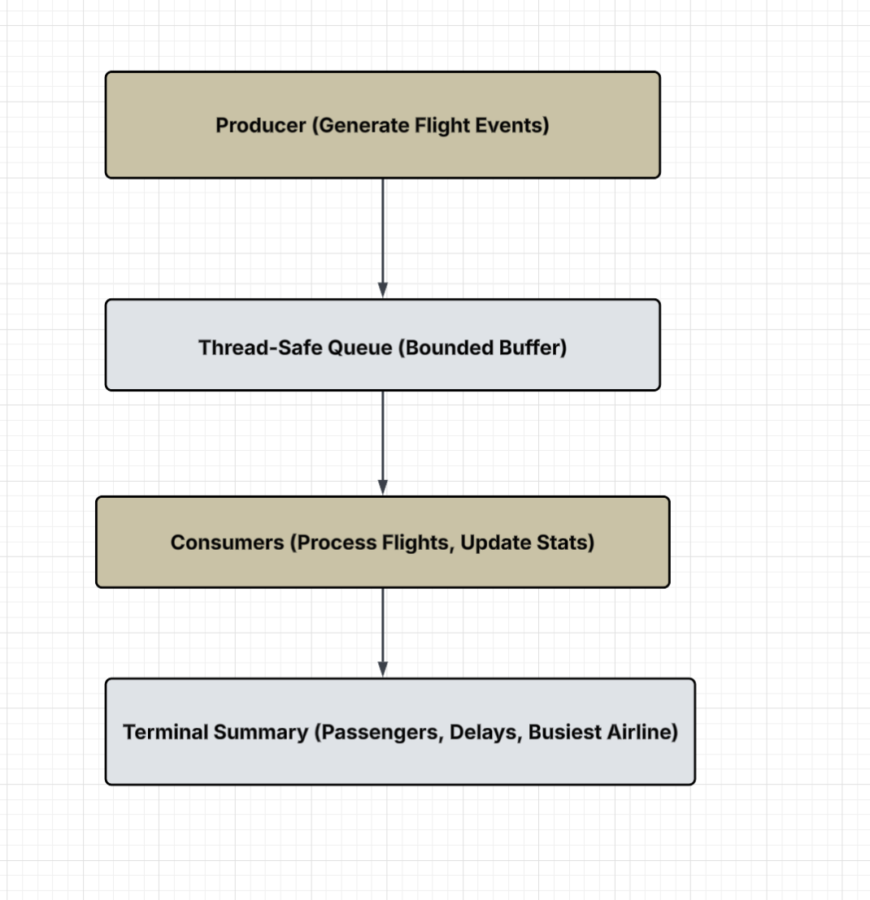
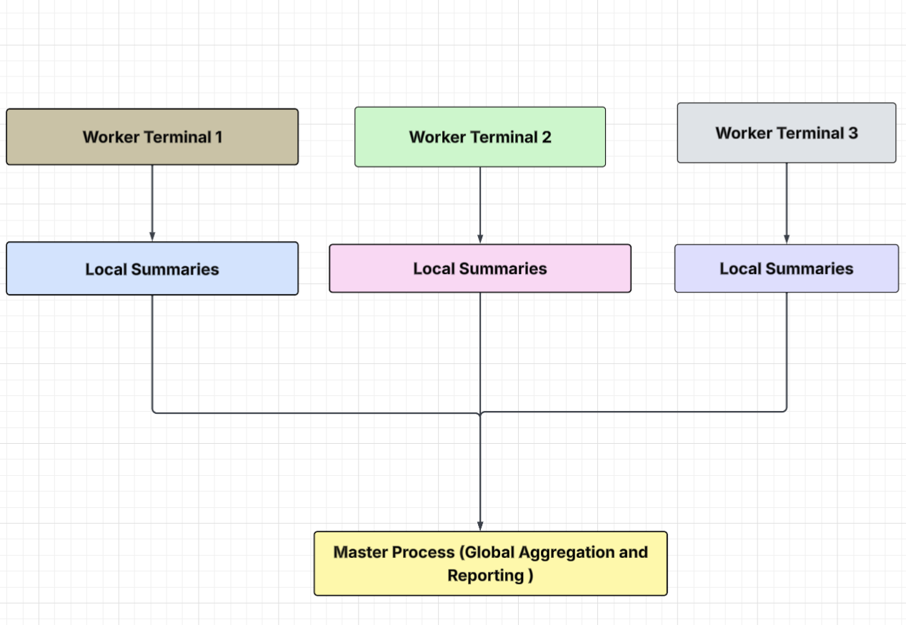
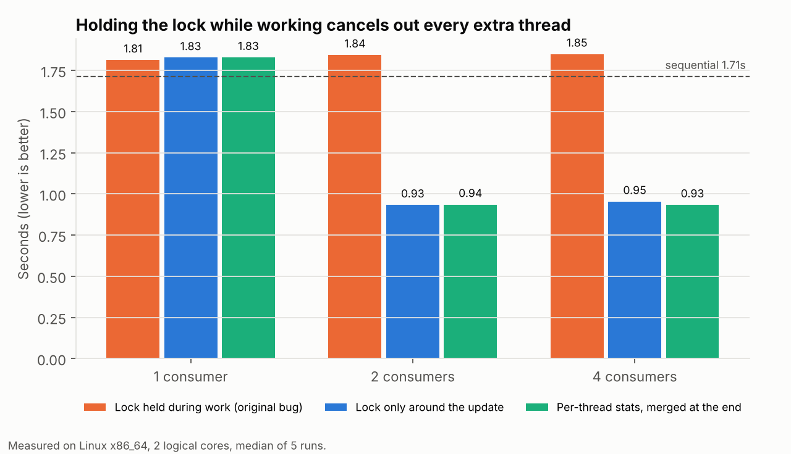
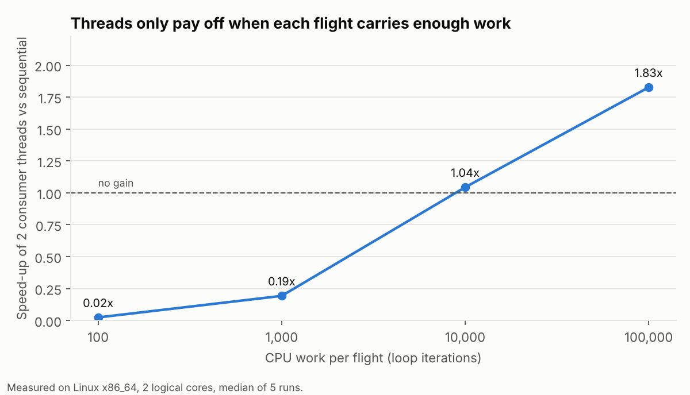
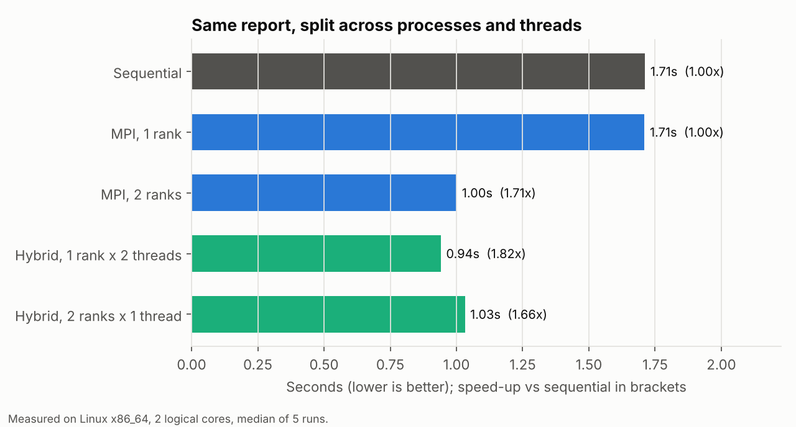

# Airport Flight Simulator (C++ threads + MPI)

A simulator of an airport's flight-processing system, built four ways on the same data:

| Program | How it runs | Key idea |
|---|---|---|
| `sequential` | one thread | baseline |
| `concurrent` | one producer thread per terminal, a pool of consumer threads, a bounded queue between them | producer-consumer |
| `distributed_mpi` | one MPI process per group of terminals, results merged on rank 0 | message passing |
| `hybrid` | MPI across terminals **and** producer-consumer threads inside each process | two-level parallelism |

Every terminal generates a stream of flights (airline, gate, passengers, status, delay). The system reports passengers, delays and cancellations, the **top N busiest terminals**, passengers and on-time rate per airline, and the busiest gate.

I designed and built this as the final project for a university course on concurrent and distributed programming (the smaller assignments from the same course are in [parallel-programming-cpp](https://github.com/tinak25/parallel-programming-cpp)). This repo is a rebuilt version. When I reviewed my original code, I found that the speed-ups in it were not real, and that one of the versions had a locking bug. Both are explained below, because finding them taught me more than writing the first version did.

## Design

| Inside one process (threads) | Across processes (MPI) |
|---|---|
|  |  |

- **Bounded queue** ([`include/bounded_queue.hpp`](include/bounded_queue.hpp)): a mutex, two condition variables (`not_full`, `not_empty`) and a `close()` call. Producers block when it is full and consumers block when it is empty, so a fast producer cannot use unlimited memory. The queue is closed only after **every** producer has finished. A single "finished" flag set by the first producer would make consumers quit while others were still sending.
- **Deterministic data** ([`include/flight.hpp`](include/flight.hpp)): flights come from a seeded generator, with a small hand-written random number generator, so every version (and every OS) simulates exactly the same flights. That is what makes the correctness test possible.
- **Delay chain**: if an airline's previous flight at a terminal was delayed, its next one is delayed with 45% probability instead of 15%, as when a late inbound aircraft makes the next departure late.
- **Terminals of different sizes**: terminal *t* schedules between 0.67x and 1.33x the average number of flights. This makes the "busiest terminal" ranking meaningful, and it creates the load-balancing effect in the MPI results.
- **MPI messages of any size** ([`include/mpi_gather.hpp`](include/mpi_gather.hpp)): each rank's summary is serialised to an array of integers. Rank 0 gathers the sizes first and then the data (`MPI_Gather` + `MPI_Gatherv`), so a summary can never overflow a fixed buffer. Rank 0 also processes its own share of terminals rather than sitting idle, and the programs work with any number of ranks, including 1 and more ranks than terminals.

## Results

All four programs print an identical report for the same seed. [`tests/check_same_results.sh`](tests/check_same_results.sh) checks this for 13 combinations of threads, lock strategies and MPI ranks. The report includes a checksum of the work done for each flight, so a version that skipped or duplicated a flight would fail the check.

Timings below are the median of 5 runs on a **2-core** Linux machine (6 terminals, ~12,000 flights). With 2 cores, the best possible speed-up is 2x. On a machine with more cores, the same scripts will show more.

### 1. The locking bug: holding a lock while working



My original hybrid version updated the shared statistics like this:

```cpp
lock_guard<mutex> lock(stats_mutex);   // lock taken...
stats.update(flight);
this_thread::sleep_for(10ms);          // ...and still held while "processing"
```

The lock is held for the whole processing step, so only one consumer can work at a time and extra threads add nothing. The `--lock held` option reproduces this: **1.84 s with 2 consumers, slower than sequential (1.71 s)**. Two fixes both reach about **0.93 s (1.84x)**:

- `--lock shared`: do the work first, then lock only for the quick counter update.
- `--lock local` (default): each consumer keeps its own statistics and merges them once at the end, so there is no lock in the hot loop at all.

Four consumers are no faster than two because the machine only has two cores.

### 2. Threads only pay off when each task is big enough



Passing a flight through the queue costs a mutex lock, a condition-variable wake-up and a context switch, about 5 microseconds here. With little work per flight that overhead dominates: 100 iterations of work per flight makes the threaded version **about 40x slower** than sequential. The break-even point is around 10,000 iterations, and at 100,000 the 2 threads reach 1.83x. Real systems handle this by batching several items per queue operation.

### 3. MPI, and why 2 ranks give 1.71x instead of 2x



With 2 ranks, terminals are dealt out round robin. Because terminals differ in size, rank 0 gets 2.5 terminals' worth of flights and rank 1 gets 3.5. Rank 0 finishes early and waits, so the best possible speed-up is 6 / 3.5 = **1.71x**, which is exactly what was measured. The threaded version does not have this problem: all consumers pull from one shared queue, so whoever is free takes the next flight. That is why `hybrid` with 1 rank x 2 threads (1.82x) beats 2 ranks x 1 thread (1.66x) on one machine. Across several machines, MPI is the only option, and a smarter terminal assignment (largest first) would fix the imbalance.

### What changed from my original version

| Original | Problem | Now |
|---|---|---|
| `sleep_for()` stood in for processing, with a different length in each version (150 ms sequential, 20-30 ms threaded, none in MPI) | The reported "6x" and "3000x" speed-ups came from shorter sleeps, not parallelism. 4 and 12 consumers took the same time (0.499 s vs 0.500 s). | Real CPU work, identical in every version (`--work`) |
| Lock held during the 10 ms processing sleep | Consumers took turns. Moving one brace halved the run time. | Lock scope fixed, plus a lock-free hot loop |
| Each version generated its own random flights with `rand()` | Results could not be compared, and `rand()` was called from several threads at once (a data race) | Seeded per-terminal generator, test that all versions agree |
| Fixed `char buffer[4096]` for MPI messages | Larger summaries would be cut off | Size-first gather |
| Master read the busiest airline from an empty map when run with 1 process | Undefined behaviour | Works with any number of ranks |
| "Top N busiest terminals" was in the design but never computed | Missing feature | Implemented |

## Run it

Requirements: a C++17 compiler, plus MPI for the two MPI programs (macOS: `brew install open-mpi`; Ubuntu: `sudo apt install libopenmpi-dev openmpi-bin`).

```bash
make            # builds all four programs into bin/
make test       # unit tests (no MPI needed)
make check      # unit tests + all versions must print the same report

./bin/sequential
./bin/concurrent --consumers 4
./bin/concurrent --consumers 4 --lock held        # reproduce the original bug
mpirun -n 3 ./bin/distributed_mpi
mpirun -n 2 ./bin/hybrid --consumers 2 --terminals 8
```

Options (all programs): `--terminals N`, `--flights AVG_PER_TERMINAL`, `--work ITERATIONS`, `--consumers N`, `--queue CAPACITY`, `--top N`, `--seed N`, `--lock held|shared|local`.

To rerun the benchmarks and redraw the charts (needs Python 3 and matplotlib):

```bash
python3 bench/run_benchmarks.py && python3 bench/make_charts.py
```

With Open MPI on a machine with few cores, add `MPI_EXTRA=--oversubscribe` in front of either command.

**Docker** (no local MPI needed):

```bash
docker build -t airport-sim .
docker run --rm airport-sim
```

## Project layout

```
include/
  flight.hpp          flight record, deterministic generator, simulated work
  stats.hpp           statistics, merge, MPI serialisation, report
  bounded_queue.hpp   thread-safe bounded queue
  engine.hpp          sequential and producer-consumer engines, options
  mpi_gather.hpp      collect variable-size summaries on rank 0
src/                  the four programs
tests/                unit tests and the cross-version check
bench/                benchmark runner and chart script
results/              benchmark data behind the charts
docs/                 design diagrams
```

## Limitations

- Flight data is synthetic, and "processing" is a CPU loop standing in for real work such as manifest checks or board updates.
- The benchmarks ran on a 2-core cloud machine. The MPI runs used 2 processes on that one machine, so they show the structure and the load-balancing effect, not cross-network costs.
